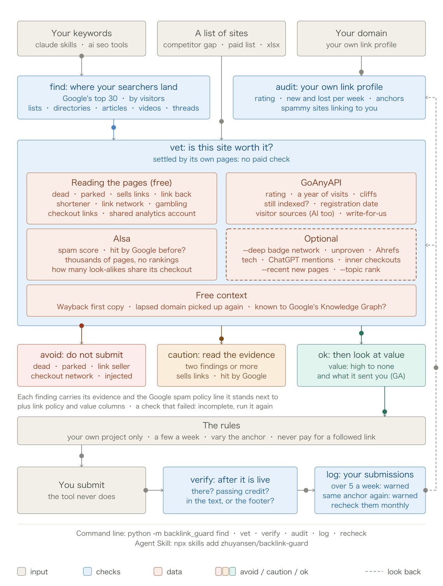

# backlink-guard

[中文](README.zh-CN.md)

Find the pages your searchers already land on, check a link source **before** you submit your site to it, check the link **after** it goes live, and look at your **own** backlink profile for the patterns Google calls link spam.

Most backlink tools help you send more. This one tells you where not to send, and when to slow down.



```bash
python -m backlink_guard vet mcpservers.org turbo0.com navi.tools
```

| Site | Verdict | Risk | Link policy | Value | Rating | Visits a month | Spam score | Why |
|---|---|---|---|---|---|---|---|---|
| mcpservers.org | ✅ ok | 1 | ⚠️ sells followed links | high | 71 | 715,667 | 12 | – |
| turbo0.com | ⚠️ caution | 4 | ⚠️ sells followed links; asks for a link back | medium | 81 | 2,218 | 5 | A high rating with almost no visitors; it lost most of its Google search traffic |
| navi.tools | ⛔ avoid | 3 | – | none | – | – | – | The domain is parked or for sale |

Two questions, answered apart. **Link policy**: what a link there would mean under Google's link spam policies, one finding being enough; mcpservers.org sells followed links, so list there for free and never pay. **Value**: what a listing can bring, which is the site's reach, or none when nobody can reach it (dead, parked, dropped by Google, a shortener, a network page). The **verdict** weighs everything: one avoid finding makes avoid, and caution takes two caution findings. Risk is 3 for each avoid finding and 1 for each caution. A site its own pages put at avoid, like navi.tools, gets no paid check.

Every finding comes with the text or the numbers it was read from:

> **turbo0.com** — ⚠️ A high rating with almost no visitors: the rating comes from links, not readers. *rating 81, about 2,218 visits a month.* ⚠️ It asks for a link or badge back as a condition. *"Free $0 … Backlink to our site is required."* (Google: Excessive link exchanges, or requiring a link as part of an arrangement)

## Where to be: find

A link is first a way in for visitors. A page that ranks for your keyword already gets the people looking for what you make, so a mention there is the most relevant link there is.

```bash
python -m backlink_guard find "claude skills" "claude code skills" "agent skills" --site agentskillshub.top
```

| Keyword | Searches a month (US) | Difficulty |
|---|---|---|
| claude skills | 40,500 | 27 |
| claude code skills | 12,100 | 30 |
| agent skills | 8,100 | 38 |

| Page | Kind | Ranks | Visitors from these searches | What to do |
|---|---|---|---|---|
| The Claude "Skills" Feature (medium.com) | article | #3 claude skills; #1 claude code skills | about 7,795 | Offer the author what the page lacks |
| Claude can now use Skills (r/ClaudeAI) | community | #2 claude skills | about 6,399 | Answer where it helps; the visitors are the value |
| addyosmani/agent-skills (GitHub) | repo | #1 agent skills | about 2,236 | An integration or a pull request, not a link request |
| Best Claude Skills in 2026 (opxskills.com) | list | #10 claude skills | about 972 | Ask to be added |
| ClaudeSkills, the curated library (claudeskills.com) | directory | #8 claude code skills | about 399 | Submit, after `vet` says it is worth it |
| agent-skills · GitHub Topics | directory | #9 agent skills | about 219 | Add the `agent-skills` topic to your repository |

Three keywords, 30 results each: $0.027 on 2026-10-14. Visitors are monthly searches times the share of clicks a position usually gets, a size and not a count. `--vet` then vets the directories and article sites it found; pages on GitHub, Medium, YouTube or Reddit are judged by the page and its author, not the platform.

## Why

Google's spam updates came in March, June, August and September 2026. "Buying or selling links", "excessive link exchanges", "low-quality directory or bookmark site links" and "using automated programs or services to create links to your site" are all on [Google's list of link spam](https://developers.google.com/search/docs/essentials/spam-policies#link-spam). Directory lists passed around for link building go stale fast and say nothing about any of this.

A verdict here is a set of signals a person can check. It is not Google's judgment: nobody outside Google can tell whether one link is counted, ignored or held against a site. Google ignores most junk links. What the tool is good for is not wasting effort on dead, empty or link-selling sites, and not building the pattern yourself.

## What it checks

| Signal | How | Source | Cost |
|---|---|---|---|
| `find`: the pages that rank for your keywords, by the visitors they get from those searches, and what kind each is | Google's top 30 for each keyword, and its monthly searches | AIsa | $0.005 a keyword, plus $0.012 |
| `--topic`: where a site ranks for your keyword, and whether its pages write about it | the same search; the site's pages | AIsa, the site | $0.005 a keyword |
| Dead, or a parked or expired domain | reads the home page; one that gives no answer at all is asked again 5 seconds later | the site | free |
| Sells followed links or posts | a price next to "dofollow", "guest post", "link insertion" on the home, submit and pricing pages | the site | free |
| Pages that invite guest or sponsored posts (a note), found even when the home page does not link to them | Google search for its "write for us" and guidelines pages | GoAnyAPI | $0.002 |
| Asks for a link or badge back | the same pages | the site | free |
| Links out to gambling, adult, loan or essay-mill sites | outbound links on the home page | the site | free |
| A URL shortener, or a link network's template page ("<domain> \| Keyword Rankings") | the page title | the site | free |
| Several sites in one check sharing one page template | the titles with each site's own name taken out | the batch | free |
| Several sites in one check reporting to one analytics or ads account (AdSense, Google Analytics, Tag Manager, Clarity, Facebook pixel): one operator | the home page | the batch | free |
| First seen | the Wayback Machine's first copy | archive.org | free |
| A lapsed domain picked up again: archived a year or more before its current registration, registered in the last three years, under 100,000 visits a month | the first copy against the registration date the visits answer carries | archive.org, GoAnyAPI | free with the visits |
| Rating, and a rating with no readers behind it (30 or more, under 5,000 visits a month) | domain rating | GoAnyAPI | $0.002 |
| Reach, and a fall in visits | 12 months of monthly visits; a fall within a month counts once a later month shows it has not come back (in the newest month it is a note), and is shown next to the Google updates that ran around it | GoAnyAPI, Google's status feed | $0.004 |
| Lost its Google search traffic and has not won it back, back to 2022 (a caution within the last year, a note before that) | monthly US Google traffic and ranking keywords; a fall counts when both fall and stay down two months, measured against twelve large sites read in the same call; shown next to the Google updates around it | AIsa, Google's status page | $0.12 a batch plus $0.0012 a site |
| Whether Google lists it | `site:` search, only for sites with few visitors; an empty answer is asked twice before it counts, and a search that fails on both sources is asked once more, never read as empty | GoAnyAPI, then AIsa | $0.004 to $0.01 |
| Spam score of the site's own backlinks, counted from 50 | one call for the batch | AIsa | $0.025 a batch |
| On the shared list of sites that build or sell spam backlinks, each with public evidence ([backlink-spam-list](https://github.com/zhuyansen/backlink-spam-list)) | the list, read once a run and kept a day; a listed site gets no paid check | GitHub | free |
| Sells links as its business ("PBN", "DR/DA" packages) | the page title | the site | free |
| Thousands of pages, almost none ranking: scaled, low-value content (sites in English) | pages in the site's own sitemaps (read up to 1.5 MB a file, so a floor) against the keywords it ranks for on US Google | the site; AIsa | free with the search history |
| `--deep`: a badge network (hundreds of links from each listed site, most in footers, nearly all followed; not read on a site with 100,000 visits a month or more), or an unproven site (under a year old, under 100 linking sites, under 1,000 visits) | backlink summary | AIsa | $0.024 a site |
| A checkout link it carries (Stripe, Gumroad, Lemon Squeezy, Polar, Creem, Dodo, Paddle) also sits on dozens of sites built like it: a network selling links through it, or a gambling or adult product injected into hacked sites. Its seller and the sites that merely cite it are not flagged. `--deep` also finds the checkout links on its inner pages, where networks put them | backlinks, plus the other sites' home pages for their titles | AIsa | about $0.02 a checkout link; with `--deep` about $0.05 more a site |
| `--recent`: whether Google takes in the pages it keeps adding | `site:` search for the last week and month, each zero asked twice, checked against the site's own sitemap | GoAnyAPI | $0.008 a site |

For your own domain (`audit`): totals and how many referring domains pass ranking credit (GoAnyAPI), new and lost referring domains by week and the anchors (AIsa), and the spam score of the sites linking to you.

Prices are what the calls cost on 2026-10-13 and 14. Paid answers are cached for 7 days.

A site its own pages already put at avoid (dead, parked, a URL shortener, a network template page, a link seller, links out to gambling sites) gets no paid check: the rest could only add to it. A site that does not load gets one question, its visits, since a site people visit that refuses the check is blocked, not dead. An ok whose check failed where it could have found something (rating, visits, index, backlink profile, checkout links, spam score, search history) is marked incomplete: run it again before relying on it.

## Tried on 31 sites (2026-10-13)

Both keys set; the whole run cost about $0.30. The raw rows with their evidence are in [docs/validation-2026-10-13.json](docs/validation-2026-10-13.json).
**Well-known directories and communities**

| Site | Verdict | Reach | Rating | Visits a month | Spam score | Flags |
|---|---|---|---|---|---|---|
| producthunt.com | ✅ ok | high | 91 | 4,339,954 | 6 | – |
| alternativeto.net | ✅ ok | high | 81 | 2,198,818 | 12 | – |
| dev.to | ✅ ok | high | 91 | 5,062,281 | 11 | – |
| libhunt.com | ✅ ok | high | 66 | 254,394 | 27 | – |
| saashub.com | ✅ ok | high | 80 | 395,908 | 7 | – |
| futurepedia.io | ✅ ok | high | 73 | 439,710 | 28 | – |
| theresanaiforthat.com | ✅ ok | high | 78 | 4,418,962 | 8 | – |
| glama.ai | ✅ ok | high | 76 | 252,499 | 4 | – |
| pulsemcp.com | ✅ ok | high | 72 | 175,498 | 5 | – |
| skills.sh | ✅ ok | high | 82 | 2,425,525 | 2 | – |

**MCP and skills directories**

| Site | Verdict | Reach | Rating | Visits a month | Spam score | Flags |
|---|---|---|---|---|---|---|
| mcpservers.org | ⚠️ caution | high | 71 | 715,667 | 12 | paid_follow |
| mcp.so | ⚠️ caution | high | 73 | 320,876 | 6 | paid_follow |
| mcpmarket.com | ⚠️ caution | high | 62 | 1,572,277 | 40 | spam_score |
| mcp.directory | ⚠️ caution | medium | 39 | 74,306 | 25 | traffic_cliff |
| agentskill.sh | ⚠️ caution | medium | 48 | 5,647 | 8 | traffic_cliff |
| skillsmp.com | ✅ ok | high | 68 | 620,591 | 19 | – |
| skillget.dev | ⚠️ caution | low | 0.1 | 0 | 60 | spam_score |

**AI tool directories and launch sites**

| Site | Verdict | Reach | Rating | Visits a month | Spam score | Flags |
|---|---|---|---|---|---|---|
| toolify.ai | ✅ ok | high | 72 | 1,051,842 | 26 | – |
| aibase.com | ⚠️ caution | high | 72 | 547,080 | 49 | spam_score |
| creati.ai | ⚠️ caution | high | 51 | 271,011 | 54 | paid_follow, traffic_cliff, spam_score |
| aitoolnet.com | ⚠️ caution | medium | 56 | 77,458 | 6 | paid_follow, traffic_cliff |
| topai.tools | ⚠️ caution | high | 64 | 506,723 | 46 | traffic_cliff, spam_score |
| turbo0.com | ⚠️ caution | medium | 81 | 2,218 | 5 | paid_follow, link_exchange, hollow_rating |
| navi.tools | ⛔ avoid | medium | 4.2 | 3,225 | 23 | parked, traffic_cliff |
| claw123.com | ⚠️ caution | medium | 3.6 | 3,135 | 53 | traffic_cliff, spam_score |
| clawhomepage.com | ✅ ok | low | 16 | 55 | 16 | – |

**Media sites that publish contributed posts**

| Site | Verdict | Reach | Rating | Visits a month | Spam score | Flags |
|---|---|---|---|---|---|---|
| programminginsider.com | ⚠️ caution | medium | 71 | 95,888 | 23 | traffic_cliff |
| nerdbot.com | ✅ ok | high | 70 | 154,161 | 33 | – |
| thedatascientist.com | ⚠️ caution | medium | 64 | 64,386 | 33 | paid_follow, traffic_cliff |
| techbullion.com | ✅ ok | high | 81 | 158,467 | 9 | – |
| aijourn.com | ⚠️ caution | high | 78 | 281,191 | 20 | traffic_cliff |

What this showed:

- **The ten well-known sites all came back clean.** No false alarm among them, after two fixes the first run forced: dev.to answers an unknown client with HTTP 406 (now "blocked", not "dead"), and a `site:` lookup returned nothing for skills.sh under load (now asked twice, and not asked at all for a site with visitors).
- **Six sites say on their own pages that they sell followed links**, and the evidence quotes them: a $39 review fee with a "Dofollow link (DR 71)", a $1,299 "dofollow placement", a "Do-Follow SEO backlink" at $9.9, "Guest Post / Link Insertion", a two-stage publishing fee.
- **Ten sites lost 46% to 80% of their visits within one month**, in August or September 2026 (the check looks at the last three months), the months of two spam updates. None of the ten well-known sites did: their September was between 74% and 181% of their August. Two cautions. It is a coincidence in time, shown as such. And seven of the ten falls are in the newest month of the data, which estimates like these sometimes revise. (Since 0.5 a fall in the newest month is a note until the next month confirms it: see the sixth test.)
- **One rating meant nothing**: 81, with about 2,200 visits a month.
- **A second test, on a paid list (2026-10-14)**: the top of a list of "backlink sources most cited by AI sites". Of its first fourteen, nine were URL shorteners or one network's "Keyword Rankings" template pages: rating 36 to 49, under 2,500 visits a month, several no longer listed by Google. The first version called most of them ok. The shortener, network and shared-template checks and the hollow-rating threshold lowered from 60 to 30 now mark all nine avoid; the 31 sites above came out the same.
- **A third test, against Ahrefs' own SPAM mark (2026-10-14)**: 90 sites linking to one young site, 33 of them marked SPAM in Ahrefs. External data reproduces the mark up to a cross-validated AUC of about 0.75, almost all of it from how new the site is, how few sites link to it and how few people visit; more features did not raise it. So the tool does not try to copy the mark. It names the two mechanisms behind most of it: `unproven` (23 hits, 17 marked; the other 6 look no better) and `badge_network` (7 hits, 4 marked; the other 3 have the same footer-badge profile). Together they catch 21 of the 33.
- **A fourth test, Google's own record (2026-10-14)**: had Google already cut these sites down? Monthly estimates of US Google traffic and ranking keywords since 2022, for the 90 sites and the 31 above. Two things in that data look like a fall and are not one. The database itself moves: in December 2021 seven in ten sites "fell" more than 60% in one month and the twelve large control sites lost a third, and in November 2024 the median fell 46% for a month. And one site's estimate can jump a hundredfold and drop back: mcpmarket.com went from 10 thousand to 3.4 million and back to 55 thousand in 2026, while Semrush showed steady growth and its ranking keywords rose the whole time. So a fall counts only when traffic and keywords fall together, held two months, measured against the controls; none of the twelve is flagged. Result: 11 of the 90 and 7 of the 31. Of the ten recent ones that visit data can check, nine lost their visits around the same month (one has bounced back since). The tenth is glama.ai: its US keywords fell from 20,535 to 432 in April 2026, Semrush shows the same fall, and its visits kept growing. It is unrelated to the Ahrefs mark: 4 of the 11 are marked, the same share as among all 90, so it carries something the mark does not. For 6 of the 11 no fall had been flagged before, and 2 of those 6 had come out ok. Across the 39 of the 90 that had 5,000 visits a month or more in July, 13 lost 40% or more of their visits in September 2026, nearly all AI tool directories; the median site kept 83%.
- **A fifth test, many pages and no rankings (2026-10-14)**: the sitemaps of the same 115 sites, read for free, against the keywords each ranks for on US Google. Pages per ranking keyword separates the Ahrefs mark at an AUC of 0.73 on its own, and it is the first signal that adds to the others: with visits, age and linking sites the cross-validated AUC rises from 0.746 to 0.776. As a rule, 1,000 or more pages for each ranking keyword (from 1,000 pages up) caught 14 of the 90, 10 of them marked; from 3,000 up, 5 of 5. Two skills directories among the 31 sit far out: 27,905 pages with no US ranking at all, and 146,670 with 219. A site in another language is left alone, since US rankings say little about it. The same test tried brand demand, whether anyone searches for the site's name, which an E-E-A-T talk proposes as a sign of authority: Google Ads volumes for the 115 names were weak (AUC 0.65) and made the combined model worse (0.731), and bare names collide with common words ("tool", "agent" and "crunch" read 450,000 to 1,000,000 a month). It was left out.
- **A sixth test, 0.4 against 0.5 (2026-10-15)**: the 90 Ahrefs-labelled sites, the 31 above and 16 sites around shared checkout links, each run with both versions (about $3.20 in all, one shared cache). On the 90 and the 31 the verdicts came out the same, but for two sites whose `site:` lookup failed in one of the runs: 0.5's new signals land on sites already marked caution. On the checkout set 0.5 turned 9 of 10 bad sites from caution to avoid (5 of 6 members of a link-selling network, 4 of 4 hacked sites carrying an injected checkout link) and flagged none of the 6 sites that merely cite those products. Three fixes followed. GoAnyAPI's September 2026 visits fell 46% to 76% for 16 of 59 sites with 5,000 a month or more, while their US Google search traffic from AIsa mostly held (one AI directory: visits down by two thirds, Google search traffic down 3%). So a fall in the newest month of the data is now a note until the next month confirms it: two of the 57 unmarked sites and two of the 31 (programminginsider.com, aijourn.com) went back to ok, and all 30 marked sites flagged before still are. The failed `site:` lookups were an "Internal SE Server Error." from AIsa's search after GoAnyAPI's own failure: such a lookup is now asked once more. And a home page that gives no answer is asked again 5 seconds later; the four unmarked sites called dead gave no answer from China or from an overseas exit either, hours apart, so those four verdicts stand. Each row now also carries its risk, 3 for each avoid finding and 1 for each caution: it ranks a marked site above an unmarked one 76% of the time, the verdict alone 62%. What remains: caution still covers 33 of the 57 unmarked sites, mostly through the spam score (19 of them at 40 or more) and through selling followed links (14). The second is a policy matter, not a misreading. The first is the next thing to settle, on a fresh set of labelled sites rather than these 90.
- **A seventh test, rules chosen on sites they had never seen (2026-10-16)**: the referring domains Ahrefs lists for two other sites of mine, an established one (872, 710 of them marked SPAM) and a new one (19), minus every site looked at before. Most of the established site's are link networks that link to everyone: 354 `.shop` sites named after SEO words, 131 long `.store` names, 84 numbered `.xyz`. A few of each went in, and the comparison leaves them out, since every rule catches them. That left 40 SPAM and 60 normal sites, run with 0.5 ($4.85 at list prices). One caution finding as a verdict flagged 43 of the 60 normal sites. The measure was fixed before the run (SPAM caught minus normal flagged, and it had to agree with the first 90), and the winner was: caution takes two caution findings, with the spam score counted from 50 rather than 40. It flags 21 of the 60 and still catches 28 of the 40; on the first 90 it flags 13 of 57 for 22 of 33. The 12 SPAM sites it lets through had one weak finding at most, and 11 of them under 1,500 visits a month; a single finding still shows under Why. Two more things showed. github.com and pypi.org came out as badge networks, because every project links them from its footer, so a site with 100,000 visits a month or more is no longer read as one. And `unproven` hit 19 normal sites and 16 SPAM here, against 6 and 17 on the first 90: new, small AI sites look like that without being spam. The Ahrefs mark has misses too: four sites it calls normal are plainly members of the networks above.
- **An eighth test, what the sites actually sent (2026-10-16)**: the young site's analytics for the last 30 days, set against its 90 referring domains. 29 of them sent at least one visit, 74 in all. Reach told them apart: 10 of the 14 rated high sent visits, 17 of the 38 rated medium, 2 of the 37 rated low. The verdict did not: the site that sent the most (10 visits) is a caution, a badge network that sells followed links. A verdict says what a link there risks; reach says what it can bring; read both. `--referrals` puts your own numbers beside them. The same day every home page was read again for its analytics and ads accounts: two pairs of sites shared an AdSense account, one of them two AI tool directories Ahrefs calls normal, now `same_owner`. Rule changes like these are checked with `scripts/regress.py`, which grades the saved results of all four labelled sets again in seconds; the labels stay out of the repository.
- **A ninth test, the established site's own analytics (2026-10-16)**: 90 days of referral sessions, with the screen sizes of known automation left out; they were few here, and the rest was 28% to 64% engaged. 9,094 sessions came from 135 sites, and only 26 of those are among the 872 referring domains Ahrefs lists: X (5,156) and GitHub (2,610) sent most, and links on X are not counted as backlinks at all. Of the 100 referring domains checked in the seventh test, 2 of the 7 rated high reach sent visits, 1 of the 20 medium and 1 of the 73 low; none of the 32 avoids sent any. One site Ahrefs marks SPAM sent 355 sessions, 64% of them engaged. What a link risks and what it brings are two questions, so the report now answers them in two columns, Link policy and Value.
- **"No page indexed in the last 30 days"**: a check passed around for paid directories. For the three it had called zombies, the same search on the same day found 9, 10 and 2 recent pages, and 4 of 14 calls timed out: a timeout read as a zero looks exactly like a zombie. Google also says `site:` counts are incomplete and new pages can take weeks. So `--recent` treats a failure as a failure, asks a zero twice, and only calls it a problem when the site's own sitemap shows new pages Google is not taking in.
- **What it cannot see**: of the five media sites that publish contributed posts, one states a fee on its pages. Whether the others charge cannot be read from their sites. A site that sells links in private is not caught by reading it.

## Commands

```bash
python -m backlink_guard find "<keyword>" [more ...] [--site yoursite.com] [--skip competitors.txt] [--vet] [--json]
python -m backlink_guard vet <site> [more ...] [--from list.xlsx] [--skip yoursite.com] [--limit 30] [--topic "keyword"] [--referrals ga4.csv] [--deep] [--recent] [--free] [--fresh] [--json]
python -m backlink_guard audit <your-domain> [--deep] [--json]
python -m backlink_guard verify <page-url> --to <your-domain>
python -m backlink_guard log add <site> --kind directory --anchor "Your Brand"
python -m backlink_guard log
python -m backlink_guard recheck [--to <your-domain>] [--deep] [--free] [--json]
```

Python 3.10 or newer, standard library only.

- **find**: $0.005 a keyword and $0.012 for the search volumes; `--vet` adds the vet cost for the sites found. `--site` leaves your own site out, `--skip` competitors.
- **vet**: about $0.01 a site, plus about $0.16 for the batch (spam scores and search history); `--topic` adds a column with where each site ranks for your keyword ($0.005 a keyword); `--free` reads the sites only. `--from` reads the sites out of a list (text, Markdown, CSV, JSON or an Excel sheet, as paid backlink lists usually come); `--skip` leaves out your own site, competitors or what you already have (sites or a list file); `--limit` caps a run at 30 sites unless raised. `--deep` adds the site's own backlink profile ($0.024 a site) and looks for its checkout links on inner pages (about $0.05, plus $0.02 a link found); `--recent` asks whether Google is taking in its new pages ($0.008 a site, and slow: GoAnyAPI's search calls take 10 to 120 seconds). Use both before paying for a placement. `--referrals` reads your analytics export (GA4's Traffic acquisition by Session source, as CSV) and adds what each site has sent you.
- **audit**: about $0.06, with `--deep` (full anchor distribution) about $0.10.
- **verify**: free. Verdicts are `followed link`, `qualified link` (nofollow, sponsored or ugc), `redirect only` (through the site's own /go/ page, also when the target is base64-encoded), `not found`, `unreadable`. Only those three rel values hold back credit; `noopener` and `external` do not. Each link also says where it sits, read from the elements around it: `body text`, `main area`, `header`, `navigation`, `sidebar`, `footer`, `comments` or `author box`. A followed link that is only in a footer, sidebar or navigation is called out: Google lists widely distributed footer, template and widget links among its link spam examples, and an editor's link in the text counts for more.
- **log**: your submissions in `state/ledger.jsonl`, with a warning past five a week or when one anchor is used over and over.
- **recheck**: the sites in your log (submitted or live) checked again and compared with the last look: a lower verdict, a new finding, and with `--to` a link of yours no longer found. Kept in `state/recheck.json`. A dozen sites cost a few cents; monthly is enough.

## Keys

Both are optional. Without them the page checks still run, and the report says what was not checked.

- **`GOANYAPI_API_KEY`** ([goanyapi.com](https://goanyapi.com/r/ga-95708898fb)): rating, visits, index status, your backlink summary.
- **`AISA_API_KEY`** ([aisa.one](https://go.aisa.one/yansen-zhu)), or `aisa login`: spam scores, weekly new and lost referring domains, anchors.

> Both links are referral links: signing up through them supports this project. The tool works the same with a key from either site directly.

The two overlap on purpose. On the day of the test GoAnyAPI's search endpoints answered 502 all day; the index question went to AIsa instead and the run completed.

## The rules it assumes

From submitting [Agent Skills Hub](https://agentskillshub.top) to directories and lists through 2026:

1. Submit only your own project, only where it fits the list.
2. Read the contribution rules first. Some lists accept humans only.
3. One pull request per list. Never resubmit to push a queue.
4. A handful a week. A hundred directory links in a week is the pattern Google describes.
5. Vary the anchor: brand, bare URL, a plain description.
6. Never pay for a followed link. A paid placement must carry `rel="sponsored"` or `nofollow`.
7. After a listing goes live, check the link. A promise of "dofollow" is often a nofollow or a redirect.

The tool does not submit anything.

## Use it from an agent

```bash
npx skills add zhuyansen/backlink-guard
```

The skill walks an agent through the same order: vet, the rules, verify, audit. It clones this repository to `~/backlink-guard` if it is not there and says the cost before a paid run.

## Limits

- Signals, not verdicts. A fall in visits next to a spam update is a coincidence in time until someone shows otherwise.
- A site that blocks unknown clients gives no page signals; the report says "blocked".
- Links added by script are not seen by `verify`.
- Private link sellers are invisible to it.
- Visit and rating numbers are third-party estimates.
- The search history is US Google only. A site whose readers are elsewhere can fall in the US and hold at home. A fall shows once two monthly readings agree, so an update that ended last week may not show yet.
- GoAnyAPI is a young service (first released August 2026). Treat it as an enhancement.

## Thanks

- [Loki Yan @loki_yan_seo](https://x.com/loki_yan_seo), whose notes on the 2026 spam updates ("follow the timeline, then go through the spam policies one by one") set the order this tool works in.
- [饭特稀 | Fentix @fantexi997](https://x.com/fantexi997) for [GoAnyAPI](https://goanyapi.com).

MIT.
