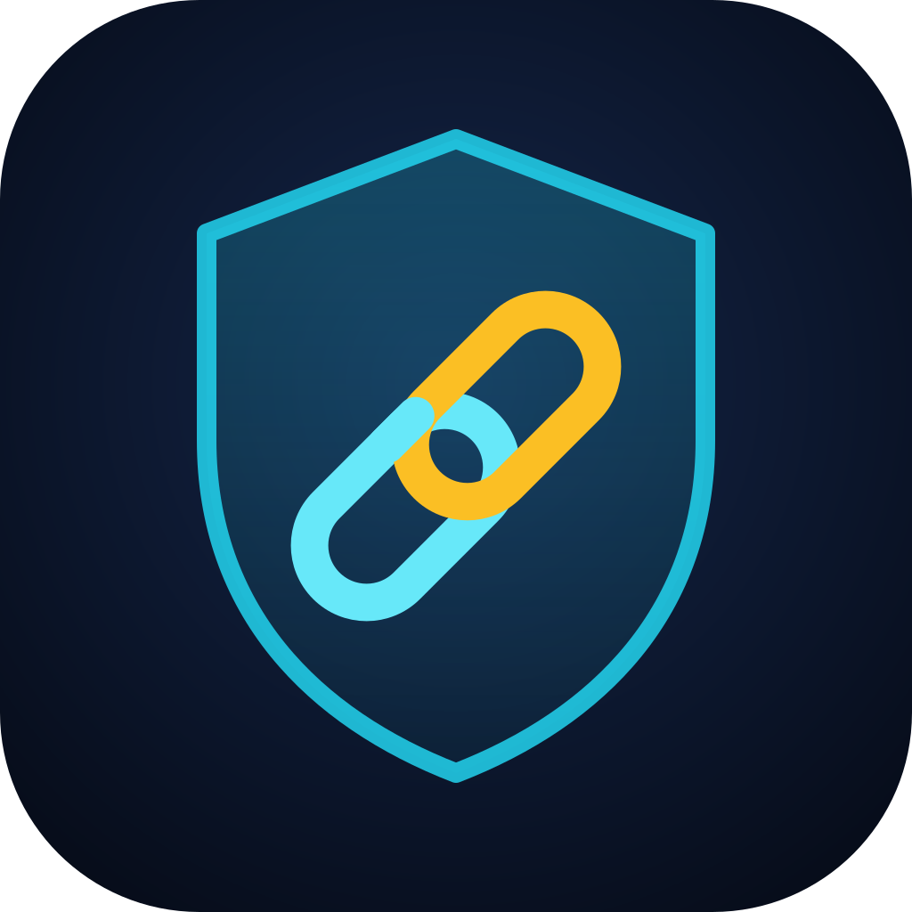

<div align="center">



# backlink-guard（外链检测）

**提交之前查外链来源，上线之后查链接，再给自己的外链做垃圾外链体检。**

[](https://pypi.org/project/backlink-guard/)
[](https://pypi.org/project/backlink-guard/)
[](LICENSE)
[](https://github.com/zhuyansen/backlink-guard/stargazers)
[](https://github.com/zhuyansen/backlink-guard/network/members)
[](https://pepy.tech/projects/backlink-guard)
[](https://github.com/zhuyansen/backlink-guard/commits/main)

[](https://registry.modelcontextprotocol.io/v0/servers?search=io.github.zhuyansen/backlink-guard)
[](https://agentskillshub.top/skill/zhuyansen/backlink-guard/)
[](https://skills.sh/zhuyansen/backlink-guard)

⭐ **在 100 个没见过的站上，Ahrefs 标为垃圾的 40 个里有 37 个没给「可以提交」** · 已上 PyPI、官方 MCP Registry、skills.sh

[快速上手](#快速上手) · [效果如何](#效果如何) · [该出现在哪](#该出现在哪find) · [竞品的外链](#竞品挣到的外链competitors) · [AI 回答](#ai-回答从哪来cited) · [Key](#key) · [在 agent 里用](#在-agent-里用skill-和-mcp-服务器) · [English](README.md)

</div>

先找出搜你这个词的人现在都落在哪些页面上、哪些站链向你的竞品却没链向你、Google 的 AI 概览（AI Overview）在你的关键词上引用了哪些站、有人向 AI 助手打听你这类产品时它们怎么回答；提交外链**之前**先查这个站值不值得发，链接上线**之后**查它是不是真的传权重，平时再看看**自己**的外链画像里有没有 Google 说的「链接垃圾」痕迹，并找出指向你已经不存在、或跳转得不好的页面的外链。

多数外链工具帮你发得更多。这个工具告诉你哪里别发、什么时候该慢下来。


## 快速上手

```bash
pip install backlink-guard
backlink-guard vet mcpservers.org turbo0.com navi.tools producthunt.com clawhomepage.com
```

需要 Python 3.10 及以上，没有任何依赖；不想安装可以用 `uvx backlink-guard vet …` 直接跑。不配 key 时只免费读对方自己的页面（`--free` 明确只做这一步）。配上 [key](#key)（GoAnyAPI，加 Glasser 或 AIsa）会加上评分、访问量、Google 收录和垃圾分：查一个站约 $0.17，三十个约 $0.46，所以想查的站最好一次一起查。

2026-10-13、14 两天配齐两个 key 的检查结果：

| 站点 | 建议 | 结论 | 风险分 | 政策风险 | 价值 | 评分 | 月访问 | 垃圾分 | 原因 |
|---|---|---|---|---|---|---|---|---|---|
| mcpservers.org | 🆓 free only | ✅ ok | 1 | ⚠️ 出售传权重的链接 | high | 71 | 715,667 | 12 | – |
| turbo0.com | 🆓 free only | ⚠️ caution | 4 | ⚠️ 出售传权重的链接；要求回链 | medium | 81 | 2,218 | 5 | 评分高但几乎没人访问；Google 搜索流量掉了大半 |
| navi.tools | ⛔ skip | ⛔ avoid | 3 | – | none | – | – | – | 域名已停放或待售 |
| producthunt.com | ✅ submit | ✅ ok | 0 | – | high | 91 | 4,339,954 | 6 | – |
| clawhomepage.com | 💤 low value | ✅ ok | 0 | – | low | 16 | 55 | 16 | – |

**建议**说的是该怎么做，它综合了另外三个答案，这三个答案也分开列出。**政策风险**：在那里拿链接，按 Google 的链接垃圾政策意味着什么，一条就列出来；mcpservers.org 出售传权重的链接，所以可以免费收录，绝不付费。**价值**：在那里上架能带来什么，看对方的触达；打不开、停放、被 Google 除名、短链、站群页面则为 none。**结论**综合所有发现：一条 avoid 就判 avoid，caution 要有两条才判。风险分：每条 avoid 记 3 分，每条 caution 记 1 分。navi.tools 这种读自己页面就判 avoid 的站，不再做付费检查。

建议和结论两栏都是工具的原样输出。建议：`skip`（跳过）、`look first`（先看看）、`free only`（只免费提交）、`low value`（价值低）、`submit`（可以提交）；结论：`ok`、`caution`（留意）、`avoid`（别发）。每条结论都带着它的依据（页面原文或数字）：

> **turbo0.com** — ⚠️ 评分高但几乎没人访问：评分是靠链接堆出来的，不是读者。*评分 81，月访问约 2,218。* ⚠️ 以回链或挂徽章为收录条件。*"Free $0 … Backlink to our site is required."*（Google：过度的链接交换，或把链接作为某种安排的条件）

几个站如果共用一个页面模板，或接的是同一个统计、广告账号（不管是同一次检查里的，还是本机之前查过的），会被标成同一个人在运营。如果其中多数还有别的问题，而[共享的垃圾外链来源库](https://github.com/zhuyansen/backlink-spam-list)里还没有它们，报告最后会附上一个已经填好的举报链接；在你自己点提交之前，什么都不会发出去。

## 效果如何

规则是在 100 个它从没见过的站上选的（2026-10-16）：Ahrefs 标了 SPAM 的 40 个，没标的 60 个。

| | 0.4.1 的规则 | 0.6 |
|---|---|---|
| 标出的 SPAM 站 | 40 个里 38 个 | 40 个里 28 个 |
| 误标的正常站 | 60 个里 46 个 | 60 个里 21 个 |
| 建议「submit」的 SPAM 站 | – | 40 个里 3 个 |

- 被判 avoid 的「正常」站，全都打不开，或在 Google 查不到页面。
- 和共用收款链接有关的 16 个站里，10 个站群或被黑的站全部建议跳过；只是引用这些产品的 6 个站里，5 个建议提交。
- 上架能带来多少访客，跟着触达走：在两个站的统计数据里，被评为低触达的来源站只有 37 个里 2 个、73 个里 1 个带来过访客，高触达的是 14 个里 10 个、7 个里 2 个。
- 十个知名目录和社区全部建议提交。

九轮测试的数据和每一轮带来的改动：[docs/validation.zh-CN.md](docs/validation.zh-CN.md)。

## 该出现在哪：find

外链首先是访客的入口。一个页面如果已经排在你的关键词上，搜这个词的人本来就会看到它；在那里被提到，就是相关性最高的外链。

```bash
python -m backlink_guard find "claude skills" "claude code skills" "agent skills" --site agentskillshub.top
```

| 关键词 | 美国月搜索量 | 难度 |
|---|---|---|
| claude skills | 40,500 | 27 |
| claude code skills | 12,100 | 30 |
| agent skills | 8,100 | 38 |

| 页面 | 类型 | 排名 | 从这些搜索得到的访客 | 能做什么 |
|---|---|---|---|---|
| The Claude "Skills" Feature（medium.com） | article | claude skills 第 3、claude code skills 第 1 | 约 7,795 | 给作者补上页面缺的东西 |
| Claude can now use Skills（r/ClaudeAI） | community | claude skills 第 2 | 约 6,399 | 在真能帮上忙的地方回答；价值在访客 |
| addyosmani/agent-skills（GitHub） | repo | agent skills 第 1 | 约 2,236 | 做集成或提 PR，而不是要链接 |
| Best Claude Skills in 2026（opxskills.com） | list | claude skills 第 10 | 约 972 | 请求加入 |
| ClaudeSkills, the curated library（claudeskills.com） | directory | claude code skills 第 8 | 约 399 | `vet` 过了再提交 |
| agent-skills · GitHub Topics | directory | agent skills 第 9 | 约 219 | 给你的仓库加上 `agent-skills` topic |

三个词、每个前 30 条：2026-10-14 花了 $0.027。访客 = 月搜索量 × 该排名通常拿到的点击比例，是量级不是精确数。`--vet` 会接着检查找到的导航站和文章站；GitHub、Medium、YouTube、Reddit 上的页面看页面和作者本身，不看平台的数据。

## 竞品挣到的外链：competitors

已经在写你竞品的站，就是最该告诉他们你在做什么的站。`competitors` 对每个竞品列出最近 7 天第一次被发现的来源域名（已经链向你的会拿掉），再列出链向两个及以上竞品、却没链向你的站（链接交集）。每个站都附上一个链过去的页面、它是哪类页面，以及在那里能正当做什么。

```bash
backlink-guard competitors yoursite.example --vs competitor-a.example competitor-b.example competitor-c.example
```

> ### competitor-a.example: 941 new referring domains; 1 already link to you, left out
>
> | Site | Rank | First seen | Linking page | Kind |
> |---|---|---|---|---|
> | agenthub.example | 195 | 2026-10-19 | [Skill install and guide](https://agenthub.example/en/p/skill-guide) | article |
> | toolsdir.example | 23 | 2026-10-16 | [Agent Skills Marketplace](https://toolsdir.example/tools/agent-skills-marketplace) | directory |
>
> ## Sites linking to two or more of them, not to you
>
> | Site | Links to | Rank | First seen | Linking page | Kind |
> |---|---|---|---|---|---|
> | compare.example | competitor-a.example, competitor-b.example | 25 | 2026-10-09 | [Best Claude skills marketplaces compared](https://compare.example/compare/claude-skills-marketplaces/) | list |

会拿掉并在最后列出：[共享垃圾外链名单](https://github.com/zhuyansen/backlink-spam-list)上的站，垃圾分 50 及以上的链接（返回的每一行都带这个分），以及链接页面标题相同的三个及以上的站（同一个站群的模板），并附上填好的举报链接。2026-10-20 实测，一个竞品最新的 100 个来源域名里有 86 个是这种页面。Rank 是该站的链接传给竞品的权重（外链库的 0 到 1,000）；First seen 是外链库的爬虫发现这条链接的时间。

链接交集只要一次调用：domain intersection 用 partial 模式，返回链向其中至少两个站的域名（它的文档写的是全部，实测是两个及以上）。每次调用约 $0.025，N 个竞品 2N + 2 次：2026-10-20 三个竞品花了 $0.20。`--max-usd` 给一次运行封顶（默认 $0.30）：只有预估还放得下才调用，7 天内缓存过的免费，封顶没问的会在报告里写明。花时间之前先 vet 一下这个站；绝不为传权重的链接付钱。

## AI 回答从哪来：cited

AI 概览会引用它写答案时用的页面。`cited` 对每个关键词读 Google 第一页和上面的 AI 概览（美国、英文），说明概览有没有引用你、你排第几，再把所有关键词里被引用的站汇总起来：在这些站上被提到，就是进到答案里的路。

```bash
backlink-guard cited yoursite.example "claude skills" "agent skills" "claude code skills" "agent skills hub"
```

| Keyword | AI Overview | Sites cited | You | Your position (organic) |
|---|---|---|---|---|
| claude skills | yes | 7 | not cited | not in the top 10 |
| agent skills hub | yes | 7 | ✅ cited: / | not in the top 10 |

2026-10-20 每个词 $0.002，概览在页面之后才加载的 $0.004；`--max-usd` 封顶（默认 $0.10）。没有 AI 概览的词会直接写明，这和「没被引用」不是一回事：Google 认为有帮助时才显示概览，换一天、换地点、换个人都可能不同。

## AI 助手怎么回答：questions 和 asked

人们也会直接问 ChatGPT、Perplexity、Claude 和 Gemini，它们回答前都会先上网搜。`questions` 写出要问的问题；`asked` 拿这些问题去问五家 AI 助手，记下每家搜了什么、读了什么、引用了什么。

```bash
backlink-guard questions "a directory of agent skills" --plain > questions.txt
backlink-guard asked yoursite.example --file questions.txt --name "Your Brand" --rank
```

- **questions**：让 ChatGPT、Claude、Gemini 各自写出它们预计会被问到的问题（不联网），合并去重：约 $0.01。
- **asked**：每个问题去问 ChatGPT（它自己的界面）、Google AI Mode、Perplexity、Claude 和 Gemini（都开联网搜索）。每家 AI 统计：多少个回答写出了你的域名、只提了你的名字、引用了你，或提到了和你同名但后缀不同的站（它的提及不算你的）；再汇总被引用最多的站和页面，标出页面类型和能做什么，以及 AI 们搜过的词（AI Mode 不显示）。
- **--rank**：把这些搜索词逐个拿到 Google 和 Bing 上查（美国、英文、前 20 名）。AI 读的是它搜到的结果，所以不在结果里的站很少被读到；排得上却没被引用的，是写答案时没被选中。报告写出你排第几，并把出现在最多搜索词第一页的站和引用它们的回答数放在一起对照。

2026-10-26 对 agentskillshub.top 跑了一轮：8 个问题、56 个回答、67 个搜索词。没有一个回答读过或引用过这个站；它在 Google 给出结果的 57 个词里只有 3 个进了前 20，在 Bing 的 67 个词里一个都没有。功夫先在搜索结果里。

ChatGPT 和 Perplexity 的回答变化最大，各问两次：按默认次数每个问题约 $0.12；`--rank` 每个搜索词在每个搜索引擎上 $0.0035。`--max-usd` 给整轮封顶（默认 $1.00）。7 天内问过的回答走缓存，所以跑完一轮再加 `--rank`，只花查排名的钱。

## 为什么做

Google 在 2026 年 3 月、6 月、8 月、9 月都发了垃圾内容更新。「买卖链接」「过度的链接交换」「低质量目录或书签站链接」「用自动化程序或服务给自己的网站创建链接」都在 [Google 的链接垃圾清单](https://developers.google.com/search/docs/essentials/spam-policies#link-spam)里。到处流传的外链目录表过期很快，而且对这些只字不提。

这里的结论是一组人可以自己核对的信号，不是 Google 的判定：Google 之外没人知道某一条链接是被计入、被忽略还是被追究。Google 对大多数垃圾链接是忽略。这个工具的用处在于：不把力气花在已死、没人看或卖链接的站上，也不让自己形成批量刷链接的痕迹。

## 查什么

| 信号 | 怎么查 | 数据来源 | 成本 |
|---|---|---|---|
| `find`：排在你关键词上的页面，按它们从这些搜索得到的访客排序，并标出页面类型 | 每个词的 Google 前 30 和月搜索量 | Glasser 或 AIsa | 每词 $0.005，另加 $0.012 |
| `--topic`：对方站在你的关键词上排第几，页面里有没有写到它 | 同一次搜索；对方的页面 | Glasser 或 AIsa、网站本身 | 每词 $0.005 |
| 打不开，或域名已停放、过期 | 读首页；完全没有响应的，5 秒后再试一次 | 网站本身 | 免费 |
| 出售传权重的链接或文章 | 首页、提交页、价格页里，价格旁边出现 dofollow、guest post、link insertion 等字样 | 网站本身 | 免费 |
| 有招客座稿、赞助文章的页面（只作提示），首页没链到也能找到 | 用 Google 搜它的「write for us」和投稿指南页 | GoAnyAPI | $0.002 |
| 要求回链或挂徽章 | 同上几个页面 | 网站本身 | 免费 |
| 站外链接指向博彩、成人、贷款、代写类网站 | 首页的站外链接 | 网站本身 | 免费 |
| 短链服务，或站群的模板页（「<域名> \| Keyword Rankings」） | 页面标题 | 网站本身 | 免费 |
| 好几个站共用一个页面模板，在这一批里，或在本机之前查过的站里 | 去掉各自站名后的标题（拦截页和平台默认标题不算） | 这一批、之前的检查 | 免费 |
| 好几个站接的是同一个统计或广告账号（AdSense、Google Analytics、Tag Manager、Clarity、Facebook 像素、Cloudflare Web Analytics），在这一批里或之前的检查里：同一个人在运营 | 首页 | 这一批、之前的检查 | 免费 |
| 最早出现时间 | Wayback Machine 的第一份存档 | archive.org | 免费 |
| Google 把它认作什么（网站、话题、公司），列在受众表里 | Google Trends 对域名和站名给出的联想 | Google Trends | 免费 |
| 域名过期后被人重新注册：第一份存档比现在的注册日期早一年以上、注册在三年内、月访问不到 10 万 | 第一份存档对比访问量接口里带的注册日期 | archive.org、GoAnyAPI | 随访问量一起，免费 |
| 评分，以及没人访问的高评分（30 分以上、月访问不到 5,000） | 域名评分（DR） | GoAnyAPI | $0.002 |
| 触达，以及访问量是否骤降 | 12 个月的逐月访问量；一个月内的骤降要等后一个月仍没回升才算（发生在最新一个月的只作提示），并和那段时间的 Google 更新并排列出 | GoAnyAPI、Google 状态页 | $0.004 |
| Google 搜索流量掉了大半、一直没回来，最早查到 2022 年（一年内的标 caution，更早的标 note） | 逐月的美国 Google 流量和排名关键词数；两者一起跌、连续两个月不回升才算，并用同一次调用里十二个大站做基准校正；和那段时间的 Google 更新并排列出 | Glasser 或 AIsa、Google 状态页 | 每批 $0.12，另加每站 $0.0012 |
| Google 是否还收录 | `site:` 搜索；只对访问量很小的站查；查两次都为空才算，两个来源都报错时隔几秒再查一次，报错绝不当成「没收录」 | GoAnyAPI，失败时转 AIsa | $0.004–0.01 |
| 该站自身外链的垃圾分，50 分起算 | 一批站一次调用 | Glasser 或 AIsa | 每批 $0.025 |
| 在共享的垃圾外链来源库里，每条附公开证据（[backlink-spam-list](https://github.com/zhuyansen/backlink-spam-list)） | 名单每次运行读一次、缓存一天；在库里的站不再做付费检查 | GitHub | 免费 |
| 以卖外链为业（标题里写着 PBN、DR/DA 套餐） | 页面标题 | 网站本身 | 免费 |
| 页面成千上万、几乎没有排名：规模化的低价值内容（只判英文站） | 对方自己 sitemap 里的页面数（每个文件最多读 1.5 MB，所以是下限）对比它在美国 Google 上排名的关键词数 | 网站本身；Glasser 或 AIsa | 随搜索历史一起，免费 |
| `--deep`：徽章站群（每个被收录的站给它几百条链接，大多在页脚，几乎全是 dofollow；月访问 10 万以上的站不判），或没有根基的新站（不到一年、来源域名不到 100、月访问不到 1,000） | 外链概况 | Glasser 或 AIsa | 每站 $0.024 |
| 它挂的收款链接（Stripe、Gumroad、Lemon Squeezy、Polar、Creem、Dodo、Paddle）同时出现在几十个和它长得一样的站上：通过这条链接卖外链的站群，或被注入到被黑网站里的赌博、色情产品。卖家本人和只是引用这个产品的站不会被标。`--deep` 还会找出它内页上的收款链接（站群都挂在内页） | 外链数据，另读那些站的首页拿标题 | Glasser 或 AIsa | 每条收款链接约 $0.02；`--deep` 每站另加约 $0.05 |
| `--recent`：它不断加的新页面 Google 收不收 | 近一周、近一月的 `site:` 搜索，结果为 0 要查两次，并对照它自己的 sitemap | GoAnyAPI | 每站 $0.008 |

「Glasser 或 AIsa」指配了哪个用哪个，两个都配时用 Glasser：两家转售的是同样的接口、同样的价格，只有两种搜索不同，`find` 的搜索（Glasser 每词 $0.006，AIsa $0.005）和 `cited` 的搜索（最多 $0.006，AIsa $0.004）。Glasser 不卖的还走 AIsa：GoAnyAPI 失败时顶上的 `site:` 搜索、`--deep` 里的 Ahrefs 评分和 Semrush 数据，以及 `questions` 和 `asked` 的全部调用。见 [Key](#key)。

查自己的域名（`audit`）：外链总量、有多少来源域名传权重（GoAnyAPI），每周新增和丢失的来源域名，逐条读最多 1,000 条外链、每个锚文本背后有几个来源域名、全站链接（Glasser 或 AIsa），给你链接的站各自的垃圾分，以及同一个人运营的来源域名（读它们的首页，免费）。`lost` 用同一批外链，找出它们指向的、你已经不存在或跳转得不好的页面。

## 自己的外链：audit 和 lost

只看链接数说明不了什么：一个站把你的链接放进页脚，它有多少页你就有多少条链接。所以每个链接数旁边都会写上来源域名数（按可注册域名算：`blog.a.example` 和 `a.example` 算一个，`alice.github.io` 和 `bob.github.io` 算两个）。一个站从 20 个以上页面链向你的同一个页面（`--sitewide` 可改），或从 3 个以上页面、且大多在页脚、侧边栏或导航里，就是全站链接：凡是算占比的地方都只算一个来源，报告里会写明。

```bash
backlink-guard audit yoursite.example
```

> - Read one by one: 60 of 1,840 links from 21 referring domains (AIsa); 40 links from 1 site, counted once
>
> ℹ️ **Some sites link to you from many of their pages (site-wide): each counts as one source.** 40 links from 40 pages of news.example to /blog/old-launch-notes, 100% in its footer, sidebar or navigation. Each site counted once in the shares here _(Google: Widely distributed links in the footers or templates of various sites)_

| Anchor | Links | Referring domains |
|---|---|---|
| YourSite | 13 | 13 |
| best csv tool | 4 | 4 |

`audit` 还会读每个来源域名的首页（免费，最多 300 个，`--homes` 可改，0 表示不读），像 `vet` 一样找它接的统计和广告账号：AdSense、Google Analytics、Tag Manager、Clarity、Facebook 像素、Cloudflare Web Analytics。同一个账号上有三个及以上的站、其中至少两个链向你，就是同一个人的站群：它的链接是同一个人投的票（只算一个来源），而专门用来发链接的站群正是 Google 垃圾政策描述的做法。这些账号会和之前查到的站群记在一起，以后 vet 别的站也会对上；共享名单里已经有一半成员时，报告会附上其余站的举报链接。读到的外链里来源域名少于 `--homes` 时（有个站最强的 1,000 条外链只来自 29 个来源域名），会再用来源域名列表（Glasser 或 AIsa）补足，300 个约 $0.035。

> ⚠️ **Several sites linking to you report to one analytics or ads account: one owner's network, whose links count as one source.** 24 referring domains in 1 network: cloudflare:0a1b2c3d… on poker-casino.example, crime-news.example, mirror.example …, 26 links. Count each network as one source _(Google: Using automated programs or services to create links to your site)_

媒体集团旗下的站、同一平台托管的站，也可能正当地共用一个账号：动手前先看看这些站。Google 会忽略大部分这类链接；拒绝链接文件（disavow）只用于人工处罚。

`lost` 会逐个询问你那些有外链指向的页面还在不在：每页一次 GET，跟随跳转，同时 4 个，最多 200 页，外链最多的先查。只有 404 和 410 才算死链，跳转链最后落到 404 也算；其他错误单独列出（被拒或没有响应），绝不算死链。每个死链页面都会给出建议的去处：你自己 sitemap 里（robots.txt 或 /sitemap.xml，跟随索引，最多 10 个文件、5 万个页面）路径最接近、且确认能打开的页面，附上 0 到 1 的匹配度，低于 0.50 不给建议。

```bash
backlink-guard lost yoursite.example
```

| Page of yours | Answer | Referring domains | Links | Strongest referring domain | Suggestion | Match |
|---|---|---|---|---|---|---|
| /blog/old-launch-notes | 404 | 8 | 8 | news.example (AIsa rank 520) | 301 to /blog/launch-notes-2026 | 0.77 |
| http://yoursite.example/tools/csv-cleaner | 410 | 3 | 3 | d0.example (AIsa rank 210) | 301 to /tools/csv-cleaner-online | 0.85 |
| /2019/careers | 404 | 1 | 1 | e.example (AIsa rank 90) | no good match (best 0.11) | – |

> ℹ️ **Sites link to pages of yours that no longer exist: the links reach nothing.** 3 pages of yours answer 404 or 410 and have links from 12 referring domains … _(Google: a page that has moved for good takes a permanent server-side redirect, 301 or 308)_

按来源域名数排序，Links 列里全站链接只算一条。工具不做任何跳转：这是一份给人看的清单，没有好匹配的页面，也许保留 404、或跳到你自己选的上级页面更合适。参考 Google 关于[跳转](https://developers.google.com/search/docs/crawling-indexing/301-redirects)的说明。

会跳转的页面，逐跳跟下去再判断，最差的排前面：**broken**（循环、超过 10 跳、或最后没有页面）；**soft-lost**（最后落在你的首页、别的站，或路径和原页面匹配度低于 0.50 的页面：Google 关于[网站迁移](https://developers.google.com/search/docs/crawling-indexing/site-move-with-url-changes)的说明里写，把旧网址都跳到首页这样不相关的页面「might be treated as a soft 404 error」，所以和死链一样给出最接近的页面）；**temporary**（途中有 302、303 或 307：Google 会继续显示旧网址）；**chain**（两跳及以上：Google 建议一跳到位）；其余为 fine。

| Page of yours | Redirect | Referring domains | Links | Verdict | Suggestion | Match |
|---|---|---|---|---|---|---|
| /old-post | 301 → / | 2 | 2 | 🔻 soft-lost: ends on your home page | 301 to /blog/old-post-renamed | 0.62 |
| /tmp | 302 → /tmp-new | 1 | 1 | ⚠️ temporary: 302, a temporary redirect | – | – |
| /zh/weekly/ | 308 → 308 → /zh/go-global/weekly | 1 | 1 | ⚠️ chain: 2 redirects in a row | – | – |

> Redirected well (one permanent hop to a page like it): 1 page(s), e.g. /zh/weekly → /zh/go-global/weekly.

价格是 2026-10-13、14 两天的实际调用成本。付费结果缓存 7 天。

读自己的页面就已经判成 avoid 的站（打不开、停放、短链、站群模板页、以卖链接为业、链向博彩），不再做付费检查：后面查出什么都只会更糟。打不开的站只问一次访问量：有人访问却拒绝检查的站是「被拦」，不是死站。看起来 ok、但有一项本可能查出问题的检查失败了（评分、访问量、收录、外链画像、收款链接、垃圾分、搜索历史），会标成 incomplete（待定）：重跑一次再用。

## 命令

```bash
backlink-guard find "<关键词>" [更多 ...] [--site 你的域名] [--skip 竞品清单.txt] [--vet] [--json]
backlink-guard vet <站点> [更多 ...] [--from 清单.xlsx] [--skip 你的域名] [--limit 30] [--topic "关键词"] [--referrals ga4.csv] [--deep] [--recent] [--free] [--fresh] [--json]
backlink-guard competitors <你的域名> --vs <竞品> [更多 ...] [--days 7] [--limit 100] [--max-usd 0.30] [--json]
backlink-guard cited <你的域名> "<关键词>" [更多 ...] [--max-usd 0.10] [--json]
backlink-guard questions "<你做的东西>" [--count 10] [--plain] [--json]
backlink-guard asked <你的域名> ["<问题>" ...] [--file 问题.txt] [--name "你的品牌名"] [--engines chatgpt,ai_mode,perplexity,claude,gemini] [--samples N] [--rank] [--max-usd 1.00] [--json]
backlink-guard audit <你的域名> [--deep] [--sitewide 20] [--rows 1000] [--homes 300] [--json]
backlink-guard lost <你的域名> [--sitewide 20] [--rows 1000] [--json]
backlink-guard verify <页面地址> --to <你的域名>
backlink-guard log add <站点> --kind directory --anchor "你的品牌名"
backlink-guard log
backlink-guard recheck [--to <你的域名>] [--deep] [--free] [--json]
```

在克隆下来的仓库里，用 `python -m backlink_guard` 效果一样。提交记录、付费结果（保留 7 天）和查到过的站群，都存在 `~/.backlink-guard`；如果是在克隆目录里运行、且里面已经有 `./state`，就继续用它。设置 `BACKLINK_GUARD_STATE` 可以换位置。

- **find**：每个词 $0.005，另加 $0.012 查搜索量；`--vet` 再加上检查找到的站的费用。`--site` 排除自己的站，`--skip` 排除竞品。
- **vet**：每个站约 $0.01，另加每批约 $0.16（垃圾分和搜索历史），一批查一个站和查三十个站这部分一样，所以想查的站一次一起查；`--topic` 多一列：每个站在你的关键词上排第几（每词 $0.005）；`--free` 只读网站本身。`--from` 从清单文件里读站点（文本、Markdown、CSV、JSON 或 Excel，付费外链榜通常是 Excel）；`--skip` 排除自己的站、竞品或已经有的（站点或清单文件）；`--limit` 默认一次最多查 30 个。`--deep` 每站约多花 $0.19：对方自己的外链画像（$0.024）、建站技术（$0.012）、ChatGPT 回答里提到它的次数（$0.10），以及它内页上的收款链接（约 $0.05，每找到一条再加 $0.02）；配了 AIsa 还会查 Ahrefs 评分（$0.08）和 Semrush 数据（$0.001）；`--recent` 查 Google 收不收它的新页面（每站 $0.008，较慢：GoAnyAPI 的搜索调用要 10 到 120 秒）。付费购买位置前两项都用上。`--referrals` 读你的统计导出（GA4「流量获取」按会话来源导出的 CSV），多一列：每个站给你带来过多少访问。检查中发现名单上没有的站群时，报告最后会附上一个已经填好的举报链接。
- **competitors**：每次调用约 $0.025，N 个竞品 2N + 2 次（三个约 $0.20）。`--days` 设定多少天内算新（7），`--limit` 设定每份列表读多少个来源域名（100，最多 1,000），`--max-usd` 设定一次最多花多少（$0.30）；缓存过的免费，封顶没问的会写明。
- **cited**：走 AIsa 每个词 $0.002，概览晚加载的 $0.004；走 Glasser 是 $0.004 和 $0.006；`--max-usd` 封顶（$0.10）。
- **questions**：三家一共约 $0.01；`--count` 设定每家写几个（10），`--plain` 只输出问题，方便存成文件。
- **asked**：ChatGPT 和 AI Mode 每个回答 $0.004，Perplexity 约 $0.006，Claude 和 Gemini 约 $0.045（2026-10-21）：ChatGPT 和 Perplexity 各问两次，每个问题约 $0.12。`--samples` 让每家都问这么多次，`--engines` 选问哪几家，`--name` 加上回答里可能用来称呼你的名字。`--rank` 每个搜索词在 Google 和 Bing 上各 $0.0035（2026-10-26）。`--max-usd` 给整轮封顶（$1.00）：出现次数最多的搜索词先查，封顶没查的会写明。
- **audit**：约 $0.12，加 `--deep`（完整锚文本分布）约 $0.16。其中约 $0.06 是逐条读 1,000 条外链（`--rows` 可以少读：2026-10-18 读 100 条花了 $0.028）。没有 Glasser 或 AIsa key 时，用 GoAnyAPI 给的前 20 个来源页面代替。另外免费读最多 300 个来源域名的首页找共用账号（`--homes` 可改，0 不读）；读到的外链里来源域名不够时，再补一次来源域名列表，约 $0.035。
- **lost**：用同一批外链，同一个站 7 天内跑过 `audit` 就不再花钱，否则约 $0.06；询问你的页面（会跳转的逐跳跟下去）、读你的 sitemap 都免费。
- **verify**：免费。结论有 `followed link`（传权重）、`qualified link`（带 nofollow、sponsored 或 ugc）、`redirect only`（经对方自己的 /go/ 跳转页，目标被 base64 编码也认得出）、`not found`、`unreadable`。只有那三个 rel 值会拦住权重，`noopener`、`external` 不会。每条链接还会标出位置，从它外层的元素读出来：`body text`（正文）、`main area`（主区域）、`header`、`navigation`、`sidebar`、`footer`、`comments`、`author box`。传权重的链接如果只在页脚、侧边栏或导航里，会单独提示：Google 把大范围分发的页脚、模板和小部件链接列为链接垃圾的例子，编辑放在正文里的链接分量更重。
- **log**：你的提交记录，存在 `ledger.jsonl`；一周超过五个、或同一个锚文本反复用时会提醒。
- **recheck**：把记录里已提交或已上线的站重查一遍，和上次比：结论变差、新查出的问题，加 `--to` 还会看你的链接还在不在。结果存在 `recheck.json`。十来个站几分钱，一个月查一次就够。

## Key

都是可选的。不配也能跑页面检查，报告会写明哪些没查。

- **`GLASSER_API_KEY`**（[glasser.ai](https://link.glasser.ai/JasonZhu)），首选：垃圾分、Google 搜索历史、每周新增和丢失的来源域名、锚文本、逐条读你的外链、竞品的来源域名、Google 的 AI 概览。
- **`AISA_API_KEY`**（[aisa.one](https://go.aisa.one/yansen-zhu)），或 `aisa login`：同样这些，没有 Glasser key 时用它；另外这几样只有 AIsa 有：AI 助手的回答和它们搜索词的结果（`questions`、`asked`）、`--deep` 里的 Ahrefs 评分和 Semrush 数据、GoAnyAPI 失败时顶上的 `site:` 搜索。只配 Glasser 时，`--deep` 不查 Ahrefs 和 Semrush，报告会写明。
- **`GOANYAPI_API_KEY`**（[goanyapi.com](https://goanyapi.com/r/ga-95708898fb)）：评分、访问量、收录情况、你自己的外链概况。

> 这三个都是推荐链接：通过它们注册等于支持这个项目。直接去官网拿 key，工具用起来完全一样。

几家是有意重叠的。测试当天 GoAnyAPI 的搜索接口全天返回 502，收录检查自动转到 AIsa，整轮照常跑完。

## 它默认你遵守的规则

来自 2026 年把 [Agent Skills Hub](https://agentskillshub.top) 提交到各目录和列表的经验：

1. 只提交自己的项目，只发到对口的列表。
2. 先读贡献规则。有些列表只接受真人提交。
3. 一个列表只提一次，不为了催队列重复提交。
4. 一周几个，不要一次一批。一周一百条目录链接正是 Google 描述的那种模式。
5. 锚文本要变：品牌名、裸网址、一句平实的描述。
6. 不花钱买传权重的链接。付费位置必须带 `rel="sponsored"` 或 `nofollow`。
7. 上线后去查链接。说好的「dofollow」经常是 nofollow 或跳转。

这个工具不替你提交任何东西。

## 在 agent 里用：skill 和 MCP 服务器

### skill

在 Claude Code 里作为插件安装（会顺带装上下面的 MCP 服务器）：

```bash
claude plugin marketplace add zhuyansen/backlink-guard
claude plugin install backlink-guard@backlink-guard
```

或者作为 skill，给任何能读 skill 的 agent 用：

```bash
npx skills add zhuyansen/backlink-guard
```

skill 带着 agent 按同样的顺序走：找该出现的地方、先查、守规则、验收、审计。它只跑 PyPI 上锁定的版本（`uvx backlink-guard==0.10.0`），不用克隆的代码；付费运行前先报成本、等你点头；读到的页面、标题、AI 回答只当数据，绝不当成指令。

### MCP 服务器

给支持 MCP 的客户端用（Claude Code、Cursor、Claude Desktop）。装了 [uv](https://docs.astral.sh/uv/) 就不用先安装任何东西：

```json
{
  "mcpServers": {
    "backlink-guard": {
      "command": "uvx",
      "args": ["--with", "mcp", "backlink-guard", "mcp"],
      "env": {
        "GLASSER_API_KEY": "...",
        "GOANYAPI_API_KEY": "..."
      }
    }
  }
}
```

没有 uv：`pip install "backlink-guard[mcp]"`，然后 `"command": "backlink-guard-mcp"`，不要 `args`。key 都是可选的，和命令行一样（见 [Key](#key)）：`questions`、`asked` 和 `--deep` 里的 Ahrefs、Semrush 数据要加 `AISA_API_KEY`，没有 Glasser key 时也可以用它代替。`BACKLINK_GUARD_STATE` 指定提交记录和缓存放在哪。在 Claude Code 里，上面的插件会带上这个服务器，并询问 key、存进系统钥匙串。

| 工具 | 返回什么 | 费用 |
|---|---|---|
| `verify` | 某个页面有没有链向你、传不传权重、链接在页面哪个位置 | 免费 |
| `submissions` | 你的提交记录和提醒 | 免费 |
| `vet` | 每个外链来源的建议、结论和证据；`free=True` 只读对方自己的页面 | 免费；或每站约 $0.01，另加每批约 $0.16；`deep` 每站约 $0.19 |
| `find` | 在你的关键词上排名的页面，按它们得到的访客排序 | 每词 $0.005–0.006，另加 $0.012 |
| `audit`、`lost` | 你自己的外链画像；落在死页面或跳转页面上的外链 | 约 $0.12（`deep` 约 $0.16）；约 $0.06 |
| `competitors` | 链向你的竞品却没链向你的站 | 每次调用约 $0.025，2N + 2 次，有封顶 |
| `cited` | Google AI 概览在你的关键词上引用了谁 | 每词 $0.002–0.006，有封顶 |
| `questions`、`asked` | 买家会怎么问 AI 助手；五家 AI 助手搜了什么、引用了谁、提到了谁 | 约 $0.01；每个问题约 $0.12，有封顶（AIsa） |

服务器给 agent 的规矩和 skill 一样：每次付费调用前先报成本、等你点头；要查的站一次放进一个 `vet` 调用；读到的内容只当数据。

### Codex、TRAE 和 WorkBuddy

同一个 skill 和服务器在这几个 agent 里也能用。它们都用 uvx 启动服务器，所以本机要先装 [uv](https://docs.astral.sh/uv/)。

**Codex。** skill：`npx skills add zhuyansen/backlink-guard -a codex`（加 `-g` 装给所有项目）。服务器写进 `~/.codex/config.toml`，命令行、IDE 插件和桌面 app 共用这一份：

```toml
[mcp_servers.backlink-guard]
command = "uvx"
args = ["--with", "mcp", "backlink-guard", "mcp"]
startup_timeout_sec = 120
tool_timeout_sec = 600

[mcp_servers.backlink-guard.env]
GLASSER_API_KEY = "..."
GOANYAPI_API_KEY = "..."
```

Codex 默认只给服务器 10 秒启动、每次工具调用 60 秒。第一次启动要下载包，一次 Glasser 查询排队最长可能等两分钟，所以两个都要像上面这样调大。`codex mcp add backlink-guard --env GLASSER_API_KEY=... -- uvx --with mcp backlink-guard mcp` 也能写入同样的配置，只是不带这两个超时。

**TRAE。** skill：`npx skills add zhuyansen/backlink-guard -a trae-cn`（国际版用 `-a trae`）。服务器：设置 → MCP → 添加 → 手动添加，粘贴上面的 JSON。TRAE CN 也可以把下面这个链接粘贴到浏览器地址栏，TRAE 会打开这个服务器的配置，填上你有的 key 再确认：

```text
trae-cn://trae.ai-ide/mcp-import?type=stdio&name=backlink-guard&config=eyJjb21tYW5kIjoidXZ4IiwiYXJncyI6WyItLXdpdGgiLCJtY3AiLCJiYWNrbGluay1ndWFyZCIsIm1jcCJdLCJlbnYiOnsiR0xBU1NFUl9BUElfS0VZIjoiIiwiQUlTQV9BUElfS0VZIjoiIiwiR09BTllBUElfQVBJX0tFWSI6IiJ9fQ%3D%3D
```

没填的 key 当作没有。

**WorkBuddy。** 把上面的 JSON 写进 `~/.workbuddy/mcp.json`，或者在侧边栏「插件」→ 右上角「MCP 服务器」→「配置 MCP」里粘贴。

## 局限

- 是信号，不是判定。访问量在垃圾更新前后下滑，只是时间上的重合。
- 拦截陌生客户端的站读不到页面信号，报告里写「被拦」。
- 由脚本后加的链接，`verify` 看不到。
- `lost` 最多读最强的 1,000 条外链；页面不存在却返回 200（软 404）的，它会当成还在。建议只比路径、不比内容：跳转前先看一眼那个页面。soft-lost 也一样：改了名、路径差别大的页面，看过之前都会被判成 soft-lost。
- `competitors` 只看得到外链库爬虫发现过的：First seen 是发现链接的时间，可能晚于链接本身。链接页面按主域名和 www. 去查，只从别的子域名链过去的站会查不到页面。标题不同、垃圾分低于 50 的站群页面会留在列表里：花时间之前先 vet。
- `cited` 只读一次美国英文结果：AI 概览随日期、地点和搜索的人而变。
- `asked` 通过各家的 API 提问（ChatGPT 走它自己的界面）：美国英文、没有历史和记忆，不等于登录用户看到的回答。同一个问题每次答案都会变，要看反复出现的。Gemini 通过 Google 的跳转链接引用，所以只知道它引用了哪些站，不知道具体页面。
- `--rank` 只读一次 Google 和 Bing 的美国英文结果。它们代表 AI 助手搜索用的索引，但每家 AI 都有自己的一套。2026-10-26 AIsa 的 Google 结果对 67 个搜索词里的 21 个返回了「Internal SE Server Error.」：失败的词会再问一次，两次都失败的算「失败」，绝不算成「你不在结果里」。
- 共用账号只从首页的原始 HTML 里读：由标签管理器或脚本后加的 ID 看不到，完全不装统计的站群也就没有可读的。
- 私下卖链接的站查不出来。
- 访问量和评分是第三方估算。
- 搜索历史只看美国 Google。读者主要在别的国家的站，可能在美国掉了、本土没掉。要两个月的数据都对得上才算下跌，所以上周刚结束的更新可能还看不出来。
- GoAnyAPI 是 2026 年 8 月才发布的新服务，只当增强项。

## 致谢

- [Loki Yan @loki_yan_seo](https://x.com/loki_yan_seo)：他关于 2026 年垃圾更新的笔记（「跟着时间线看，再照着垃圾政策一条条排」）定下了这个工具的检查顺序。
- [饭特稀 | Fentix @fantexi997](https://x.com/fantexi997)：[GoAnyAPI](https://goanyapi.com)。

MIT。
