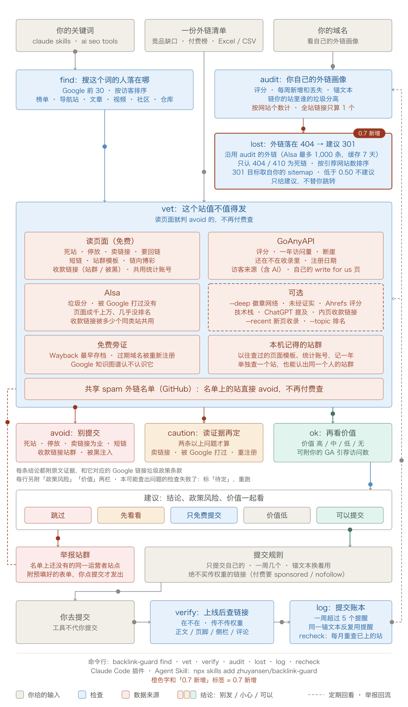

# backlink-guard

[English](README.md)

先找出搜你这个词的人现在都落在哪些页面上，提交外链**之前**先查这个站值不值得发，链接上线**之后**查它是不是真的传权重，平时再看看**自己**的外链画像里有没有 Google 说的「链接垃圾」痕迹。

多数外链工具帮你发得更多。这个工具告诉你哪里别发、什么时候该慢下来。



```bash
python -m backlink_guard vet mcpservers.org turbo0.com navi.tools
```

| 站点 | 结论 | 触达 | 评分 | 月访问 | 垃圾分 | 原因 |
|---|---|---|---|---|---|---|
| mcpservers.org | ⚠️ caution | high | 71 | 715,667 | 12 | 出售传权重的链接或文章 |
| turbo0.com | ⚠️ caution | medium | 81 | 2,218 | 5 | 评分高但几乎没人访问；出售链接；要求回链 |
| navi.tools | ⛔ avoid | medium | 4.2 | 3,225 | 23 | 域名已停放或待售 |

结论一栏是工具的原样输出：`ok`、`caution`（留意）、`avoid`（别发）。每条结论都带着它的依据（页面原文或数字）：

> **turbo0.com** — ⚠️ 评分高但几乎没人访问：评分是靠链接堆出来的，不是读者。*评分 81，月访问约 2,218。* ⚠️ 以回链或挂徽章为收录条件。*"Free $0 … Backlink to our site is required."*（Google：过度的链接交换，或把链接作为某种安排的条件）

## 该出现在哪：find

外链首先是访客的入口。一个页面如果已经排在你的关键词上，搜这个词的人本来就会看到它；在那里被提到，就是相关性最高的外链。

```bash
python -m backlink_guard find "claude skills" "claude code skills" "agent skills" --site agentskillshub.top
```

| 关键词 | 美国月搜索量 | 难度 |
|---|---|---|
| claude skills | 40,500 | 27 |
| claude code skills | 12,100 | 30 |
| agent skills | 8,100 | 38 |

| 页面 | 类型 | 排名 | 从这些搜索得到的访客 | 能做什么 |
|---|---|---|---|---|
| The Claude "Skills" Feature（medium.com） | article | claude skills 第 3、claude code skills 第 1 | 约 7,795 | 给作者补上页面缺的东西 |
| Claude can now use Skills（r/ClaudeAI） | community | claude skills 第 2 | 约 6,399 | 在真能帮上忙的地方回答；价值在访客 |
| addyosmani/agent-skills（GitHub） | repo | agent skills 第 1 | 约 2,236 | 做集成或提 PR，而不是要链接 |
| Best Claude Skills in 2026（opxskills.com） | list | claude skills 第 10 | 约 972 | 请求加入 |
| ClaudeSkills, the curated library（claudeskills.com） | directory | claude code skills 第 8 | 约 399 | `vet` 过了再提交 |
| agent-skills · GitHub Topics | directory | agent skills 第 9 | 约 219 | 给你的仓库加上 `agent-skills` topic |

三个词、每个前 30 条：2026-10-14 花了 $0.027。访客 = 月搜索量 × 该排名通常拿到的点击比例，是量级不是精确数。`--vet` 会接着检查找到的导航站和文章站；GitHub、Medium、YouTube、Reddit 上的页面看页面和作者本身，不看平台的数据。

## 为什么做

Google 在 2026 年 3 月、6 月、8 月、9 月都发了垃圾内容更新。「买卖链接」「过度的链接交换」「低质量目录或书签站链接」「用自动化程序或服务给自己的网站创建链接」都在 [Google 的链接垃圾清单](https://developers.google.com/search/docs/essentials/spam-policies#link-spam)里。到处流传的外链目录表过期很快，而且对这些只字不提。

这里的结论是一组人可以自己核对的信号，不是 Google 的判定：Google 之外没人知道某一条链接是被计入、被忽略还是被追究。Google 对大多数垃圾链接是忽略。这个工具的用处在于：不把力气花在已死、没人看或卖链接的站上，也不让自己形成批量刷链接的痕迹。

## 查什么

| 信号 | 怎么查 | 数据来源 | 成本 |
|---|---|---|---|
| `find`：排在你关键词上的页面，按它们从这些搜索得到的访客排序，并标出页面类型 | 每个词的 Google 前 30 和月搜索量 | AIsa | 每词 $0.005，另加 $0.012 |
| `--topic`：对方站在你的关键词上排第几，页面里有没有写到它 | 同一次搜索；对方的页面 | AIsa、网站本身 | 每词 $0.005 |
| 打不开，或域名已停放、过期 | 读首页 | 网站本身 | 免费 |
| 出售传权重的链接或文章 | 首页、提交页、价格页里，价格旁边出现 dofollow、guest post、link insertion 等字样 | 网站本身 | 免费 |
| 要求回链或挂徽章 | 同上几个页面 | 网站本身 | 免费 |
| 站外链接指向博彩、成人、贷款、代写类网站 | 首页的站外链接 | 网站本身 | 免费 |
| 短链服务，或站群的模板页（「<域名> \| Keyword Rankings」） | 页面标题 | 网站本身 | 免费 |
| 同一批里好几个站共用一个页面模板 | 去掉各自站名后的标题 | 这一批 | 免费 |
| 最早出现时间 | Wayback Machine 的第一份存档 | archive.org | 免费 |
| 评分，以及没人访问的高评分（30 分以上、月访问不到 5,000） | 域名评分（DR） | GoAnyAPI | $0.002 |
| 触达，以及访问量是否骤降 | 12 个月的逐月访问量；一个月内的骤降会和那段时间的 Google 更新并排列出 | GoAnyAPI、Google 状态页 | $0.004 |
| Google 搜索流量掉了大半、一直没回来，最早查到 2022 年（一年内的标 caution，更早的标 note） | 逐月的美国 Google 流量和排名关键词数；两者一起跌、连续两个月不回升才算，并用同一次调用里十二个大站做基准校正；和那段时间的 Google 更新并排列出 | AIsa、Google 状态页 | 每批 $0.12，另加每站 $0.0012 |
| Google 是否还收录 | `site:` 搜索；只对访问量很小的站查，并且查两次都为空才算 | GoAnyAPI，失败时转 AIsa | $0.004–0.01 |
| 该站自身外链的垃圾分 | 一批站一次调用 | AIsa | 每批 $0.025 |
| 以卖外链为业（标题里写着 PBN、DR/DA 套餐） | 页面标题 | 网站本身 | 免费 |
| 页面成千上万、几乎没有排名：规模化的低价值内容（只判英文站） | 对方自己 sitemap 里的页面数（每个文件最多读 1.5 MB，所以是下限）对比它在美国 Google 上排名的关键词数 | 网站本身；AIsa | 随搜索历史一起，免费 |
| `--deep`：徽章站群（每个被收录的站给它几百条链接，大多在页脚，几乎全是 dofollow），或没有根基的新站（不到一年、来源域名不到 100、月访问不到 1,000） | 外链概况 | AIsa | 每站 $0.024 |
| `--recent`：它不断加的新页面 Google 收不收 | 近一周、近一月的 `site:` 搜索，结果为 0 要查两次，并对照它自己的 sitemap | GoAnyAPI | 每站 $0.008 |

查自己的域名（`audit`）：外链总量、有多少来源域名传权重（GoAnyAPI），每周新增和丢失的来源域名、锚文本分布（AIsa），以及给你链接的站各自的垃圾分。

价格是 2026-10-13、14 两天的实际调用成本。付费结果缓存 7 天。

## 在 31 个站上试过（2026-10-13）

两个 key 都配了，整轮约 $0.30。带依据的原始结果在 [docs/validation-2026-10-13.json](docs/validation-2026-10-13.json)。

**知名目录和社区**

| 站点 | 结论 | 触达 | 评分 | 月访问 | 垃圾分 | 标记 |
|---|---|---|---|---|---|---|
| producthunt.com | ✅ ok | high | 91 | 4,339,954 | 6 | – |
| alternativeto.net | ✅ ok | high | 81 | 2,198,818 | 12 | – |
| dev.to | ✅ ok | high | 91 | 5,062,281 | 11 | – |
| libhunt.com | ✅ ok | high | 66 | 254,394 | 27 | – |
| saashub.com | ✅ ok | high | 80 | 395,908 | 7 | – |
| futurepedia.io | ✅ ok | high | 73 | 439,710 | 28 | – |
| theresanaiforthat.com | ✅ ok | high | 78 | 4,418,962 | 8 | – |
| glama.ai | ✅ ok | high | 76 | 252,499 | 4 | – |
| pulsemcp.com | ✅ ok | high | 72 | 175,498 | 5 | – |
| skills.sh | ✅ ok | high | 82 | 2,425,525 | 2 | – |

**MCP 和 skills 目录**

| 站点 | 结论 | 触达 | 评分 | 月访问 | 垃圾分 | 标记 |
|---|---|---|---|---|---|---|
| mcpservers.org | ⚠️ caution | high | 71 | 715,667 | 12 | paid_follow |
| mcp.so | ⚠️ caution | high | 73 | 320,876 | 6 | paid_follow |
| mcpmarket.com | ⚠️ caution | high | 62 | 1,572,277 | 40 | spam_score |
| mcp.directory | ⚠️ caution | medium | 39 | 74,306 | 25 | traffic_cliff |
| agentskill.sh | ⚠️ caution | medium | 48 | 5,647 | 8 | traffic_cliff |
| skillsmp.com | ✅ ok | high | 68 | 620,591 | 19 | – |
| skillget.dev | ⚠️ caution | low | 0.1 | 0 | 60 | spam_score |

**AI 工具目录和发布站**

| 站点 | 结论 | 触达 | 评分 | 月访问 | 垃圾分 | 标记 |
|---|---|---|---|---|---|---|
| toolify.ai | ✅ ok | high | 72 | 1,051,842 | 26 | – |
| aibase.com | ⚠️ caution | high | 72 | 547,080 | 49 | spam_score |
| creati.ai | ⚠️ caution | high | 51 | 271,011 | 54 | paid_follow, traffic_cliff, spam_score |
| aitoolnet.com | ⚠️ caution | medium | 56 | 77,458 | 6 | paid_follow, traffic_cliff |
| topai.tools | ⚠️ caution | high | 64 | 506,723 | 46 | traffic_cliff, spam_score |
| turbo0.com | ⚠️ caution | medium | 81 | 2,218 | 5 | paid_follow, link_exchange, hollow_rating |
| navi.tools | ⛔ avoid | medium | 4.2 | 3,225 | 23 | parked, traffic_cliff |
| claw123.com | ⚠️ caution | medium | 3.6 | 3,135 | 53 | traffic_cliff, spam_score |
| clawhomepage.com | ✅ ok | low | 16 | 55 | 16 | – |

**接收投稿的媒体站**

| 站点 | 结论 | 触达 | 评分 | 月访问 | 垃圾分 | 标记 |
|---|---|---|---|---|---|---|
| programminginsider.com | ⚠️ caution | medium | 71 | 95,888 | 23 | traffic_cliff |
| nerdbot.com | ✅ ok | high | 70 | 154,161 | 33 | – |
| thedatascientist.com | ⚠️ caution | medium | 64 | 64,386 | 33 | paid_follow, traffic_cliff |
| techbullion.com | ✅ ok | high | 81 | 158,467 | 9 | – |
| aijourn.com | ⚠️ caution | high | 78 | 281,191 | 20 | traffic_cliff |


看到了什么：

- **十个知名站全部通过**，没有误报。第一轮跑出两个误判，已修：dev.to 对不认识的客户端返回 HTTP 406（现在记为「被拦」而不是「打不开」）；并发下 `site:` 查询对 skills.sh 返回了空（现在空结果要再查一次，而且有访问量的站干脆不查）。
- **六个站在自己的页面上写明出售传权重的链接**，依据里引的是它们的原话：39 美元审核费附带「Dofollow link (DR 71)」、1,299 美元的「dofollow placement」、9.9 美元的「Do-Follow SEO backlink」、「Guest Post / Link Insertion」、两段式发稿费。
- **十个站在一个月内掉了 46% 到 80% 的访问量**，都发生在 2026 年 8 月或 9 月（检查只看最近三个月），正是两次垃圾更新的月份。十个知名站没有一个这样：它们 9 月的访问量是 8 月的 74% 到 181%。两点提醒：这只是时间上的重合，工具也只这样表述；十个里有七个发生在数据的最新一个月，这类估算数据的最新月份有时会被修正。
- **有一个评分毫无意义**：81 分，月访问约 2,200。
- **第二轮测试：一份付费外链榜（2026-10-14）**：榜单是「被最多 AI 站引用的外链来源」，前 14 名里有 9 个是短链服务或同一站群的「Keyword Rankings」模板页：评分 36 到 49，月访问不到 2,500，好几个已经不被 Google 收录。第一版把它们大多判成 ok。加上短链、站群、共用模板三项检查，并把「空壳高评分」的门槛从 60 降到 30 之后，这 9 个全部判为 avoid；上面那 31 个站的结论没有变化。
- **第三轮测试：对照 Ahrefs 自己的 SPAM 标记（2026-10-14）**：一个新站的 90 个来源域名，Ahrefs 标了其中 33 个 SPAM。用外部数据复现这个标记，交叉验证 AUC 最多约 0.75，几乎全部来自「站有多新、链它的站多少、访问多少」三项，再加特征也提不上去。所以工具不去复刻这个标记，而是把背后的两种机制标出来：`unproven`（命中 23 个，17 个被标；另外 6 个看着也一样差）和 `badge_network`（命中 7 个，4 个被标；另外 3 个是同样的页脚徽章画像）。两条合起来覆盖 33 个里的 21 个。
- **第四轮测试：Google 自己的记录（2026-10-14）**：这些站是不是早就被 Google 打过？取 2022 年以来逐月的美国 Google 流量和排名关键词估算，覆盖那 90 个站和上面 31 个。数据里有两种「下跌」其实不是站本身的问题。一是数据库自己会变：2021 年 12 月，七成的站在一个月内「跌」了 60% 以上，十二个大站基准也掉了三成；2024 年 11 月中位数跌了 46%，下个月又回来。二是单个站的估算可能暴涨一百倍再掉回去：mcpmarket.com 在 2026 年从 1 万涨到 340 万、又回到 5.5 万，而 Semrush 显示它一直稳步增长，排名关键词数也一路在涨。所以只有流量和关键词一起跌、连续两个月、并且相对基准也在跌，才算一次下跌；十二个基准站一个都没被标。结果：90 个里标出 11 个，31 个里标出 7 个。能用访问量核对的十个近期案例里，九个在同一个月前后访问量也掉了（其中一个后来回升）。第十个是 glama.ai：它的美国关键词在 2026 年 4 月从 20,535 个掉到 432 个，Semrush 显示同样的下跌，但它的访问量还在涨。这项和 Ahrefs 的标记没有关系：11 个里有 4 个被标，和 90 个整体的比例一样，所以它带来的是那个标记里没有的信息。11 个里有 6 个以前没有任何下跌提示，其中 2 个原来判的是 ok。90 个里 7 月访问量过 5,000 的有 39 个，其中 13 个在 2026 年 9 月掉了 40% 以上的访问量，几乎都是 AI 工具导航站；中位数站点保住了 83%。
- **第五轮测试：页面很多、几乎没有排名（2026-10-14）**：免费读同样 115 个站自己的 sitemap，和它们在美国 Google 上排名的关键词数对比。「每个排名词对应多少页面」单独就能以 AUC 0.73 区分 Ahrefs 的标记，也是第一个能叠加到其他信号上的：和访问量、站龄、来源域名一起，交叉验证 AUC 从 0.746 升到 0.776。按规则算，每个排名词 1,000 页以上（且总页数过 1,000）的在 90 个里命中 14 个，其中 10 个被标；3,000 页以上的 5 个全被标。31 个站里有两个 skill 导航站远远超标：一个 27,905 页、美国排名词一个都没有，一个 146,670 页、只有 219 个。别的语言的站不判，美国排名说明不了它。同一轮还试了「品牌需求」（有没有人搜这个站的名字，一份 E-E-A-T 讲稿把它当权威性的代理指标）：115 个名字的 Google Ads 搜索量区分力弱（AUC 0.65），加进去整体反而变差（0.731）；而且裸名字会撞上普通词（"tool"、"agent"、"crunch" 每月 45 万到 100 万）。所以没有上。
- **「近 30 天 0 收录」**：圈子里流传的付费目录检查。被它判为僵尸站的三个站，同一天同样的搜索查到了 9、10、2 条近期页面；14 次调用里有 4 次超时——把超时当成 0，看起来就跟僵尸站一模一样。Google 也说 `site:` 计数不完整、新页面可能要几周才收录。所以 `--recent` 失败就是失败，结果为 0 要查两次，并且只有对方 sitemap 显示在发新页、Google 却不收时才提示。
- **它看不到的**：五个接收投稿的媒体站里，只有一个在页面上写了收费。其余几个是否收费，从网站上读不出来。私下卖链接的站靠读页面查不出来。

## 命令

```bash
python -m backlink_guard find "<关键词>" [更多 ...] [--site 你的域名] [--skip 竞品清单.txt] [--vet] [--json]
python -m backlink_guard vet <站点> [更多 ...] [--from 清单.xlsx] [--skip 你的域名] [--limit 30] [--topic "关键词"] [--deep] [--recent] [--free] [--fresh] [--json]
python -m backlink_guard audit <你的域名> [--deep] [--json]
python -m backlink_guard verify <页面地址> --to <你的域名>
python -m backlink_guard log add <站点> --kind directory --anchor "你的品牌名"
python -m backlink_guard log
```

Python 3.10 及以上，只用标准库。

- **find**：每个词 $0.005，另加 $0.012 查搜索量；`--vet` 再加上检查找到的站的费用。`--site` 排除自己的站，`--skip` 排除竞品。
- **vet**：每个站约 $0.01，另加每批约 $0.16（垃圾分和搜索历史）；`--topic` 多一列：每个站在你的关键词上排第几（每词 $0.005）；`--free` 只读网站本身。`--from` 从清单文件里读站点（文本、Markdown、CSV、JSON 或 Excel，付费外链榜通常是 Excel）；`--skip` 排除自己的站、竞品或已经有的（站点或清单文件）；`--limit` 默认一次最多查 30 个。`--deep` 加查对方自己的外链画像（每站 $0.024）；`--recent` 查 Google 收不收它的新页面（每站 $0.008，较慢：GoAnyAPI 的搜索调用要 10 到 120 秒）。付费购买位置前两项都用上。
- **audit**：约 $0.06，加 `--deep`（完整锚文本分布）约 $0.10。
- **verify**：免费。结论有 `followed link`（传权重）、`qualified link`（带 nofollow、sponsored 或 ugc）、`redirect only`（经对方自己的 /go/ 跳转页，目标被 base64 编码也认得出）、`not found`、`unreadable`。只有那三个 rel 值会拦住权重，`noopener`、`external` 不会。每条链接还会标出位置，从它外层的元素读出来：`body text`（正文）、`main area`（主区域）、`header`、`navigation`、`sidebar`、`footer`、`comments`、`author box`。传权重的链接如果只在页脚、侧边栏或导航里，会单独提示：Google 把大范围分发的页脚、模板和小部件链接列为链接垃圾的例子，编辑放在正文里的链接分量更重。
- **log**：你的提交记录，存在本机 `state/ledger.jsonl`；一周超过五个、或同一个锚文本反复用时会提醒。

## Key

两个都是可选的。不配也能跑页面检查，报告会写明哪些没查。

- **`GOANYAPI_API_KEY`**（[goanyapi.com](https://goanyapi.com/r/ga-95708898fb)）：评分、访问量、收录情况、你自己的外链概况。
- **`AISA_API_KEY`**（[aisa.one](https://go.aisa.one/yansen-zhu)），或 `aisa login`：垃圾分、每周新增和丢失的来源域名、锚文本。

> 这两个都是推荐链接：通过它们注册等于支持这个项目。直接去官网拿 key，工具用起来完全一样。

两家是有意重叠的。测试当天 GoAnyAPI 的搜索接口全天返回 502，收录检查自动转到 AIsa，整轮照常跑完。

## 它默认你遵守的规则

来自 2026 年把 [Agent Skills Hub](https://agentskillshub.top) 提交到各目录和列表的经验：

1. 只提交自己的项目，只发到对口的列表。
2. 先读贡献规则。有些列表只接受真人提交。
3. 一个列表只提一次，不为了催队列重复提交。
4. 一周几个，不要一次一批。一周一百条目录链接正是 Google 描述的那种模式。
5. 锚文本要变：品牌名、裸网址、一句平实的描述。
6. 不花钱买传权重的链接。付费位置必须带 `rel="sponsored"` 或 `nofollow`。
7. 上线后去查链接。说好的「dofollow」经常是 nofollow 或跳转。

这个工具不替你提交任何东西。

## 让 agent 用

```bash
npx skills add zhuyansen/backlink-guard
```

skill 带着 agent 按同样的顺序走：先查、守规则、验收、审计。本地没有这个仓库时它会克隆到 `~/backlink-guard`，付费运行前会先报成本。

## 局限

- 是信号，不是判定。访问量在垃圾更新前后下滑，只是时间上的重合。
- 拦截陌生客户端的站读不到页面信号，报告里写「被拦」。
- 由脚本后加的链接，`verify` 看不到。
- 私下卖链接的站查不出来。
- 访问量和评分是第三方估算。
- 搜索历史只看美国 Google。读者主要在别的国家的站，可能在美国掉了、本土没掉。要两个月的数据都对得上才算下跌，所以上周刚结束的更新可能还看不出来。
- GoAnyAPI 是 2026 年 8 月才发布的新服务，只当增强项。

## 致谢

- [Loki Yan @loki_yan_seo](https://x.com/loki_yan_seo)：他关于 2026 年垃圾更新的笔记（「跟着时间线看，再照着垃圾政策一条条排」）定下了这个工具的检查顺序。
- [饭特稀 | Fentix @fantexi997](https://x.com/fantexi997)：[GoAnyAPI](https://goanyapi.com)。

MIT。
